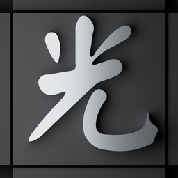

<h1> MuTracer</h1>

[](https://www.npmjs.com/package/@meimu/mutracer)
[](./LICENSE)

**MuTracer** is a physically based path tracer for the web.
It renders on WebGPU and falls back to WebGL 2, with OpenPBR materials,
TinyBVH acceleration and denoising built in.

Try the [online demo](https://mutracer.meimu-studio.com) or open the
[viewer](https://mutracer.meimu-studio.com/viewer/). MuTracer is a 0.x library;
APIs may change between minor releases.

- **Progressive path tracing**: area, sphere, spot (with IES profiles),
  directional and environment lights, with multiple importance sampling.
- **OpenPBR 1.1 materials**: metal, dielectric, coat, fuzz, thin film,
  transmission with absorption and scattering, subsurface, emission, and
  ray-marched height-field displacement.
- **Fast scene setup**: a JavaScript port of TinyBVH's binned SAH builder
  builds acceleration structures, with the TinyBVH WebAssembly builder as an
  option; transform-only animation refits the instance hierarchy.
- **Denoising**: one call enables a built-in joint non-local means filter
  (WebGPU and WebGL 2) or Intel Open Image Denoise (WebGPU), for the final
  image or while the image converges.
- **Three.js friendly**: keep a `THREE.Scene` (loaded with `GLTFLoader` or
  built by hand) in sync with `THREESceneSync`.
- **Production output**: AgX, ACES, Cineon, Reinhard and linear tone mapping, color
  grading, bloom, shadow catchers, transparent backgrounds, depth of field and
  offline rendering with adaptive sampling.

## Install

```bash
npm install @meimu/mutracer
```

Install `three` to load glTF with `GLTFLoader` + `THREESceneSync` or to use
the Three.js helpers. The quick start below also uses `gl-matrix` for matrix math.

The package is ESM with TypeScript declarations (`lib/main.js`). A UMD build
with a `MuTracer` global is at `dist/mutracer.umd.js`.

## Quick start

```ts
import { mat4 } from 'gl-matrix';
import {
  Camera, EnvironmentLight, Mesh, OpenPBRMaterial, RectLight, Renderer,
  Texture, createPlaneGeometry, createSphereGeometry, type Scene
} from '@meimu/mutracer';

const canvas = document.querySelector('canvas')!;

const red = new OpenPBRMaterial();
red.baseColor = [0.8, 0.1, 0.1];
red.specularRoughness = 0.3;

const ball = new Mesh(createSphereGeometry(64, 32), red);
mat4.fromTranslation(ball.transform, [0, 1, 0]);

const floor = new Mesh(createPlaneGeometry(), new OpenPBRMaterial());
mat4.fromScaling(floor.transform, [5, 1, 5]);

// Rect lights emit along their local -Z axis.
const light = new RectLight([2, 2], [1, 1, 1], 5);
mat4.fromTranslation(light.transform, [0, 4, 0]);
mat4.rotateX(light.transform, light.transform, -Math.PI / 2);

// A constant grey sky as a 1x1 float environment map.
const sky = new Texture({ data: new Float32Array([0.3, 0.3, 0.3, 1]), width: 1, height: 1 });

const scene: Scene = {
  meshes: [ball, floor],
  lights: [light, new EnvironmentLight(sky)]
};

const camera = new Camera('perspective', 40, canvas.width / canvas.height, 0.1, 100);
Camera.lookAt(camera, [0, 2, 6], [0, 1, 0]);

const renderer = new Renderer({ canvas });
renderer.setSize(canvas.width, canvas.height);

function frame() {
  renderer.render(scene, camera); // adds samples until renderer.maxSamples
  requestAnimationFrame(frame);
}
frame();
```

With Three.js:

```ts
import { Renderer, THREESceneSync, fromTHREECamera } from '@meimu/mutracer';

const renderer = new Renderer({ canvas });
const sync = new THREESceneSync(threeScene);

function frame() {
  sync.update();
  renderer.render(sync.scene, fromTHREECamera(threeCamera));
  requestAnimationFrame(frame);
}
frame();
```

Enable denoising:

```ts
await renderer.setDenoiser();                  // built-in JNLM filter
await renderer.setDenoiser({ type: 'oidn' });  // Intel Open Image Denoise
```

## Documentation

| Guide | Contents |
| --- | --- |
| [Getting started](./docs/getting-started.md) | Scene model, render loop, lights, export |
| [Scene updates](./docs/updates.md) | Editing a rendering scene, animation, update costs |
| [API reference](./docs/api.md) | Renderer options, methods, status codes, scene types |
| [Materials](./docs/materials.md) | OpenPBR inputs, textures, alpha, bevel, displacement |
| [Three.js](./docs/threejs.md) | `THREESceneSync`, supported materials and lights, `userData` keys |
| [Denoising](./docs/denoising.md) | JNLM and OIDN denoisers, OIDN weights hosting, denoising while converging |
| [Sampling](./docs/sampling.md) | Patterns, dimensions and progressive budgets |
| [BVH](./docs/bvh.md) | BVH builders, TinyBVH layouts, worker preparation |
| [Performance](./docs/performance.md) | Tuning checklist |
| [`llms.txt`](./llms.txt) | Compact usage guide for coding agents |

The [examples](./examples) cover a procedural scene, a Three.js/glTF scene and
an OpenPBR gallery with denoising and PNG export. Run them with:

```bash
npm install
npm run dev
```

## Browser support

- **WebGPU** (recommended): any browser with WebGPU, such as current Chrome,
  Edge and Safari. Required for OIDN denoising, HDR output and
  the options marked WebGPU in the [API reference](./docs/api.md).
- **WebGL 2** fallback: requires `EXT_color_buffer_float`. Pass
  `preferWebGPU: false` to force it.

The first frame compiles large shaders, which can take several seconds on some
platforms; `render()` reports the progress through its return status.

## Contributing

See [CONTRIBUTING.md](./CONTRIBUTING.md) for development setup, required checks
and GPU validation.

## License

MuTracer is released under the [MIT License](./LICENSE). It includes third-party
code and data under MIT, Apache-2.0 and CC0 licenses; see
[THIRD_PARTY_NOTICES.md](./THIRD_PARTY_NOTICES.md).
